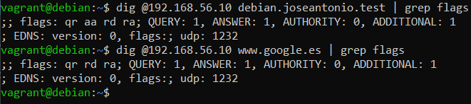

# Checking authority (aa flag)

## Local domain

Command:

```bash
dig @192.168.56.10 debian.joseantonio.test | grep flags
```

Output:

```
;; flags: qr aa rd ra; QUERY: 1, ANSWER: 1, AUTHORITY: 0, ADDITIONAL: 1
; EDNS: version: 0, flags:; udp: 1232
```

The response includes the `aa` flag.

## External domain

Command:

```bash
dig @192.168.56.10 www.google.es | grep flags
```

Output:

```
;; flags: qr rd ra; QUERY: 1, ANSWER: 1, AUTHORITY: 0, ADDITIONAL: 1
; EDNS: version: 0, flags:; udp: 1232
```

The response does not include `aa`.

## Explanation

The `aa` flag appears for `joseantonio.test` because the server is authoritative (master) for that zone. It does not appear for `www.google.es` because the response comes from recursive resolution (and the cache), not from a zone hosted on this server.

