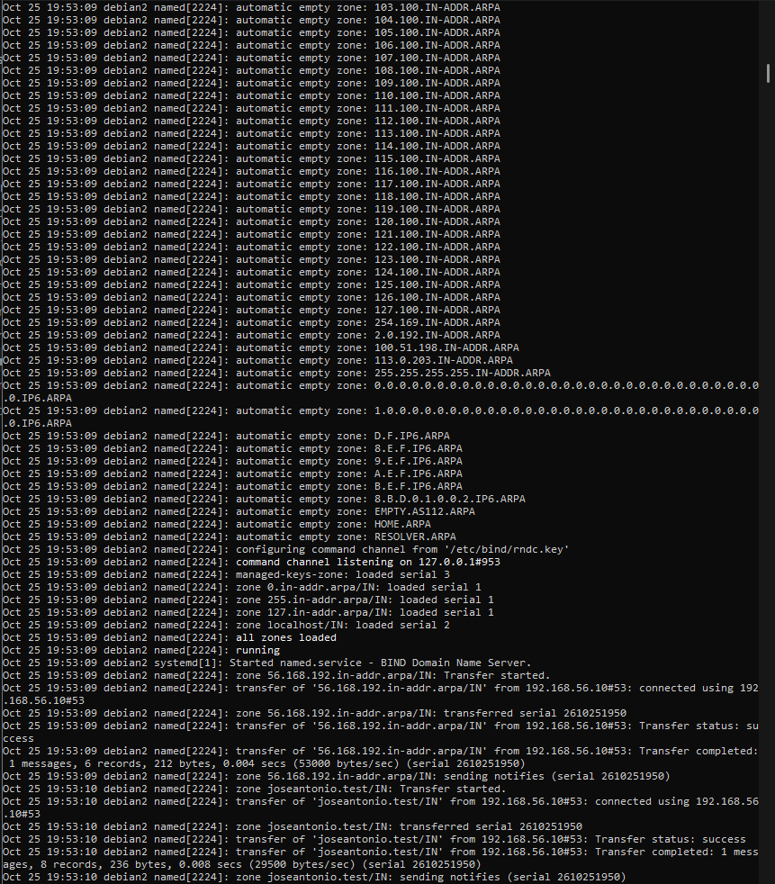

# Secondary server

## Adding the secondary server to the zones

Commands (on `primario`):

```bash
cat /var/lib/bind/joseantonio.test.dns
cat /var/lib/bind/joseantonio.test.rev
```

Output:

```
vagrant@debian:~$ cat /var/lib/bind/joseantonio.test.dns
;
; joseantonio.test
;
$TTL    86400
@   IN  SOA debian.joseantonio.test. admin.joseantonio.test. (
            2610251950 ; Serial (YYMMDDhhmm)
            3600     ; Refresh
            1800     ; Retry
            604800   ; Expire
            86400 )  ; Negative Cache TTL
;
@        IN  NS    debian.joseantonio.test.
@        IN  NS    debian2.joseantonio.test.
@        IN  TXT   "jasc-dotcom-github"
debian   IN  A     192.168.56.10
debian2  IN  A     192.168.56.11
web      IN  CNAME debian.joseantonio.test.
vagrant@debian:~$ cat /var/lib/bind/joseantonio.test.rev
;
; 56.168.192.in-addr.arpa
;
$TTL    86400
@   IN  SOA debian.joseantonio.test. admin.joseantonio.test. (
            2610251950 ; Serial
            3600     ; Refresh
            1800     ; Retry
            604800   ; Expire
            86400 )  ; Negative Cache TTL
;
@                 IN  NS   debian.joseantonio.test.
@                 IN  NS   debian2.joseantonio.test.
10                IN  PTR  debian.joseantonio.test.
11                IN  PTR  debian2.joseantonio.test.
```

The NS and A records for `debian2` and its PTR record are added. The serial must be changed whenever a zone is modified: provisioning generates a new one (`YYMMDDhhmm`); if you edit the zone manually, increment the serial or the secondary will not detect the change.

## Secondary server options

Command (on `secundario`):

```bash
cat /etc/bind/named.conf.options
```

Output:

```
acl confiables {
    127.0.0.1;
    192.168.56.0/24;
};

options {
    directory "/var/cache/bind";

    // forwarders {
    //   0.0.0.0;
    // };

    allow-transfer { none; };
    listen-on port 53 { 127.0.0.1; 192.168.56.11; };

    recursion yes;
    allow-recursion { confiables; };

    dnssec-validation yes;

    // listen-on-v6 { any; };
};
```

The ACL is the same as on the primary; only the IP address in `listen-on` changes.

## Slave zones

Command:

```bash
cat /etc/bind/named.conf.local
```

Output:

```
zone "joseantonio.test" {
    type master;
    file "/var/lib/bind/joseantonio.test.dns";
    allow-transfer { 192.168.56.11; };
};

zone "56.168.192.in-addr.arpa" {
    type master;
    file "/var/lib/bind/joseantonio.test.rev";
    allow-transfer { 192.168.56.11; };
};
```

The zones are `slave`, and `masters` points to the primary (`192.168.56.10`). Do not create zone files manually.

## Transfer refused (expected error)

If the primary has not yet authorized the secondary, the transfer fails because the global `allow-transfer { none; }` setting denies it.

Command (on `secundario`):

```bash
sudo journalctl -u named --no-pager | grep -iE "refused|transfer"
dig @192.168.56.11 joseantonio.test SOA +norecurse | grep -E "status|flags"
ls -l /var/cache/bind/
```

The secondary's log shows `REFUSED` for the transfer, the `joseantonio.test.dns` and `joseantonio.test.rev` files do not appear in `/var/cache/bind`, and `dig` returns `SERVFAIL`.

Command (on `primario`):

```bash
sudo journalctl -u named --no-pager | grep -i "denied"
```

The primary logs that the transfer requested by `192.168.56.11` was denied.

## Authorizing transfers on the primary (solution)

Command (on `primario`):

```bash
grep -n allow-transfer /etc/bind/named.conf.local
```

Output:

```
4:    allow-transfer { 192.168.56.11; };
10:    allow-transfer { 192.168.56.11; };
```

Only the secondary's IP address can transfer the zones. After reprovisioning the primary, the secondary receives the zones.

## Transferred files

Command (on `secundario`):

```bash
ls -l /var/cache/bind/
```

Output:

```
total 16
-rw-r--r-- 1 bind bind 457 Oct 25 19:53 joseantonio.test.dns
-rw-r--r-- 1 bind bind 391 Oct 25 19:53 joseantonio.test.rev
-rw-r--r-- 1 bind bind 221 Oct 25 19:53 managed-keys.bind
-rw-r--r-- 1 bind bind 906 Oct 25 19:53 managed-keys.bind.jnl
```

BIND has saved `joseantonio.test.dns` and `joseantonio.test.rev`, received from the primary.

## Transfer log

Command:

```bash
sudo journalctl -u named --since "10 minutes ago" --no-pager
```

Output:

```
Oct 25 19:53:04 debian2 systemd[1]: Starting named.service - BIND Domain Name Server...
Oct 25 19:53:04 debian2 named[2109]: starting BIND 9.18.49-1~deb12u2-Debian (Extended Support Version) <id:>
Oct 25 19:53:04 debian2 named[2109]: running on Linux x86_64 6.1.0-29-amd64 #1 SMP PREEMPT_DYNAMIC Debian 6.1.123-1 (2025-01-02)
Oct 25 19:53:04 debian2 named[2109]: built with  '--build=x86_64-linux-gnu' '--prefix=/usr' '--includedir=${prefix}/include' '--mandir=${prefix}/share/man' '--infodir=${prefix}/share/info' '--sysconfdir=/etc' '--localstatedir=/var' '--disable-option-checking' '--disable-silent-rules' '--libdir=${prefix}/lib/x86_64-linux-gnu' '--runstatedir=/run' '--disable-maintainer-mode' '--disable-dependency-tracking' '--libdir=/usr/lib/x86_64-linux-gnu' '--sysconfdir=/etc/bind' '--with-python=python3' '--localstatedir=/' '--enable-threads' '--enable-largefile' '--with-libtool' '--enable-shared' '--disable-static' '--with-gost=no' '--with-openssl=/usr' '--with-gssapi=yes' '--with-libidn2' '--with-json-c' '--with-lmdb=/usr' '--with-gnu-ld' '--with-maxminddb' '--with-atf=no' '--enable-ipv6' '--enable-rrl' '--enable-filter-aaaa' '--disable-native-pkcs11' '--enable-dnstap' 'build_alias=x86_64-linux-gnu' 'CFLAGS=-g -O2 -ffile-prefix-map=/build/reproducible-path/bind9-9.18.49=. -fstack-protector-strong -Wformat -Werror=format-security -fno-strict-aliasing -fno-delete-null-pointer-checks -DNO_VERSION_DATE -DDIG_SIGCHASE' 'LDFLAGS=-Wl,-z,relro -Wl,-z,now' 'CPPFLAGS=-Wdate-time -D_FORTIFY_SOURCE=2'
Oct 25 19:53:04 debian2 named[2109]: running as: named -f -u bind
Oct 25 19:53:04 debian2 named[2109]: compiled by GCC 12.2.0
Oct 25 19:53:04 debian2 named[2109]: compiled with OpenSSL version: OpenSSL 3.0.20 7 Apr 2026
Oct 25 19:53:04 debian2 named[2109]: linked to OpenSSL version: OpenSSL 3.0.15 3 Sep 2024
Oct 25 19:53:04 debian2 named[2109]: compiled with libuv version: 1.44.2
Oct 25 19:53:04 debian2 named[2109]: linked to libuv version: 1.44.2
Oct 25 19:53:04 debian2 named[2109]: compiled with libxml2 version: 2.9.14
Oct 25 19:53:04 debian2 named[2109]: linked to libxml2 version: 20914
Oct 25 19:53:04 debian2 named[2109]: compiled with json-c version: 0.16
Oct 25 19:53:04 debian2 named[2109]: linked to json-c version: 0.16
Oct 25 19:53:04 debian2 named[2109]: compiled with zlib version: 1.2.13
Oct 25 19:53:04 debian2 named[2109]: linked to zlib version: 1.2.13
Oct 25 19:53:04 debian2 named[2109]: ----------------------------------------------------
Oct 25 19:53:04 debian2 named[2109]: BIND 9 is maintained by Internet Systems Consortium,
Oct 25 19:53:04 debian2 named[2109]: Inc. (ISC), a non-profit 501(c)(3) public-benefit
Oct 25 19:53:04 debian2 named[2109]: corporation.  Support and training for BIND 9 are
Oct 25 19:53:04 debian2 named[2109]: available at https://www.isc.org/support
Oct 25 19:53:04 debian2 named[2109]: ----------------------------------------------------
Oct 25 19:53:04 debian2 named[2109]: adjusted limit on open files from 524288 to 1048576
Oct 25 19:53:04 debian2 named[2109]: found 2 CPUs, using 2 worker threads
Oct 25 19:53:04 debian2 named[2109]: using 2 UDP listeners per interface
Oct 25 19:53:04 debian2 named[2109]: DNSSEC algorithms: RSASHA1 NSEC3RSASHA1 RSASHA256 RSASHA512 ECDSAP256SHA256 ECDSAP384SHA384 ED25519 ED448
Oct 25 19:53:04 debian2 named[2109]: DS algorithms: SHA-1 SHA-256 SHA-384
Oct 25 19:53:04 debian2 named[2109]: HMAC algorithms: HMAC-MD5 HMAC-SHA1 HMAC-SHA224 HMAC-SHA256 HMAC-SHA384 HMAC-SHA512
Oct 25 19:53:04 debian2 named[2109]: TKEY mode 2 support (Diffie-Hellman): yes
Oct 25 19:53:04 debian2 named[2109]: TKEY mode 3 support (GSS-API): yes
Oct 25 19:53:04 debian2 named[2109]: the initial working directory is '/'
Oct 25 19:53:04 debian2 named[2109]: loading configuration from '/etc/bind/named.conf'
Oct 25 19:53:04 debian2 named[2109]: the working directory is now '/var/cache/bind'
Oct 25 19:53:04 debian2 named[2109]: reading built-in trust anchors from file '/etc/bind/bind.keys'
Oct 25 19:53:04 debian2 named[2109]: looking for GeoIP2 databases in '/usr/share/GeoIP'
Oct 25 19:53:04 debian2 named[2109]: using default UDP/IPv4 port range: [32768, 60999]
Oct 25 19:53:04 debian2 named[2109]: using default UDP/IPv6 port range: [32768, 60999]
Oct 25 19:53:04 debian2 named[2109]: listening on IPv4 interface lo, 127.0.0.1#53
Oct 25 19:53:04 debian2 named[2109]: listening on IPv4 interface eth0, 10.0.2.15#53
Oct 25 19:53:04 debian2 named[2109]: listening on IPv4 interface eth1, 192.168.56.11#53
Oct 25 19:53:04 debian2 named[2109]: IPv6 socket API is incomplete; explicitly binding to each IPv6 address separately
Oct 25 19:53:04 debian2 named[2109]: listening on IPv6 interface lo, ::1#53
Oct 25 19:53:04 debian2 named[2109]: listening on IPv6 interface eth0, fd17:625c:f037:2:a00:27ff:fe8d:c04d#53
Oct 25 19:53:04 debian2 named[2109]: listening on IPv6 interface eth0, fe80::a00:27ff:fe8d:c04d%2#53
Oct 25 19:53:04 debian2 named[2109]: listening on IPv6 interface eth1, fe80::a00:27ff:fe34:c3b%3#53
Oct 25 19:53:04 debian2 named[2109]: generating session key for dynamic DNS
Oct 25 19:53:04 debian2 named[2109]: sizing zone task pool based on 5 zones
Oct 25 19:53:04 debian2 named[2109]: none:100: 'max-cache-size 90%' - setting to 411MB (out of 457MB)
Oct 25 19:53:04 debian2 named[2109]: obtaining root key for view _default from '/etc/bind/bind.keys'
Oct 25 19:53:04 debian2 named[2109]: set up managed keys zone for view _default, file 'managed-keys.bind'
Oct 25 19:53:04 debian2 named[2109]: automatic empty zone: 10.IN-ADDR.ARPA
Oct 25 19:53:04 debian2 named[2109]: automatic empty zone: 16.172.IN-ADDR.ARPA
Oct 25 19:53:04 debian2 named[2109]: automatic empty zone: 17.172.IN-ADDR.ARPA
Oct 25 19:53:04 debian2 named[2109]: automatic empty zone: 18.172.IN-ADDR.ARPA
Oct 25 19:53:04 debian2 named[2109]: automatic empty zone: 19.172.IN-ADDR.ARPA
Oct 25 19:53:04 debian2 named[2109]: automatic empty zone: 20.172.IN-ADDR.ARPA
Oct 25 19:53:04 debian2 named[2109]: automatic empty zone: 21.172.IN-ADDR.ARPA
Oct 25 19:53:04 debian2 named[2109]: automatic empty zone: 22.172.IN-ADDR.ARPA
Oct 25 19:53:04 debian2 named[2109]: automatic empty zone: 23.172.IN-ADDR.ARPA
Oct 25 19:53:04 debian2 named[2109]: automatic empty zone: 24.172.IN-ADDR.ARPA
Oct 25 19:53:04 debian2 named[2109]: automatic empty zone: 25.172.IN-ADDR.ARPA
Oct 25 19:53:04 debian2 named[2109]: automatic empty zone: 26.172.IN-ADDR.ARPA
Oct 25 19:53:04 debian2 named[2109]: automatic empty zone: 27.172.IN-ADDR.ARPA
Oct 25 19:53:04 debian2 named[2109]: automatic empty zone: 28.172.IN-ADDR.ARPA
Oct 25 19:53:04 debian2 named[2109]: automatic empty zone: 29.172.IN-ADDR.ARPA
Oct 25 19:53:04 debian2 named[2109]: automatic empty zone: 30.172.IN-ADDR.ARPA
Oct 25 19:53:04 debian2 named[2109]: automatic empty zone: 31.172.IN-ADDR.ARPA
Oct 25 19:53:04 debian2 named[2109]: automatic empty zone: 168.192.IN-ADDR.ARPA
Oct 25 19:53:04 debian2 named[2109]: automatic empty zone: 64.100.IN-ADDR.ARPA
Oct 25 19:53:04 debian2 named[2109]: automatic empty zone: 65.100.IN-ADDR.ARPA
Oct 25 19:53:04 debian2 named[2109]: automatic empty zone: 66.100.IN-ADDR.ARPA
Oct 25 19:53:04 debian2 named[2109]: automatic empty zone: 67.100.IN-ADDR.ARPA
Oct 25 19:53:04 debian2 named[2109]: automatic empty zone: 68.100.IN-ADDR.ARPA
Oct 25 19:53:04 debian2 named[2109]: automatic empty zone: 69.100.IN-ADDR.ARPA
Oct 25 19:53:04 debian2 named[2109]: automatic empty zone: 70.100.IN-ADDR.ARPA
Oct 25 19:53:04 debian2 named[2109]: automatic empty zone: 71.100.IN-ADDR.ARPA
Oct 25 19:53:04 debian2 named[2109]: automatic empty zone: 72.100.IN-ADDR.ARPA
Oct 25 19:53:04 debian2 named[2109]: automatic empty zone: 73.100.IN-ADDR.ARPA
Oct 25 19:53:04 debian2 named[2109]: automatic empty zone: 74.100.IN-ADDR.ARPA
Oct 25 19:53:04 debian2 named[2109]: automatic empty zone: 75.100.IN-ADDR.ARPA
Oct 25 19:53:04 debian2 named[2109]: automatic empty zone: 76.100.IN-ADDR.ARPA
Oct 25 19:53:04 debian2 named[2109]: automatic empty zone: 77.100.IN-ADDR.ARPA
Oct 25 19:53:04 debian2 named[2109]: automatic empty zone: 78.100.IN-ADDR.ARPA
Oct 25 19:53:04 debian2 named[2109]: automatic empty zone: 79.100.IN-ADDR.ARPA
Oct 25 19:53:04 debian2 named[2109]: automatic empty zone: 80.100.IN-ADDR.ARPA
Oct 25 19:53:04 debian2 named[2109]: automatic empty zone: 81.100.IN-ADDR.ARPA
Oct 25 19:53:04 debian2 named[2109]: automatic empty zone: 82.100.IN-ADDR.ARPA
Oct 25 19:53:04 debian2 named[2109]: automatic empty zone: 83.100.IN-ADDR.ARPA
Oct 25 19:53:04 debian2 named[2109]: automatic empty zone: 84.100.IN-ADDR.ARPA
Oct 25 19:53:04 debian2 named[2109]: automatic empty zone: 85.100.IN-ADDR.ARPA
Oct 25 19:53:04 debian2 named[2109]: automatic empty zone: 86.100.IN-ADDR.ARPA
Oct 25 19:53:04 debian2 named[2109]: automatic empty zone: 87.100.IN-ADDR.ARPA
Oct 25 19:53:04 debian2 named[2109]: automatic empty zone: 88.100.IN-ADDR.ARPA
Oct 25 19:53:04 debian2 named[2109]: automatic empty zone: 89.100.IN-ADDR.ARPA
Oct 25 19:53:04 debian2 named[2109]: automatic empty zone: 90.100.IN-ADDR.ARPA
Oct 25 19:53:04 debian2 named[2109]: automatic empty zone: 91.100.IN-ADDR.ARPA
Oct 25 19:53:04 debian2 named[2109]: automatic empty zone: 92.100.IN-ADDR.ARPA
Oct 25 19:53:04 debian2 named[2109]: automatic empty zone: 93.100.IN-ADDR.ARPA
Oct 25 19:53:04 debian2 named[2109]: automatic empty zone: 94.100.IN-ADDR.ARPA
Oct 25 19:53:04 debian2 named[2109]: automatic empty zone: 95.100.IN-ADDR.ARPA
Oct 25 19:53:04 debian2 named[2109]: automatic empty zone: 96.100.IN-ADDR.ARPA
Oct 25 19:53:04 debian2 named[2109]: automatic empty zone: 97.100.IN-ADDR.ARPA
Oct 25 19:53:04 debian2 named[2109]: automatic empty zone: 98.100.IN-ADDR.ARPA
Oct 25 19:53:04 debian2 named[2109]: automatic empty zone: 99.100.IN-ADDR.ARPA
Oct 25 19:53:04 debian2 named[2109]: automatic empty zone: 100.100.IN-ADDR.ARPA
Oct 25 19:53:04 debian2 named[2109]: automatic empty zone: 101.100.IN-ADDR.ARPA
Oct 25 19:53:04 debian2 named[2109]: automatic empty zone: 102.100.IN-ADDR.ARPA
Oct 25 19:53:04 debian2 named[2109]: automatic empty zone: 103.100.IN-ADDR.ARPA
Oct 25 19:53:04 debian2 named[2109]: automatic empty zone: 104.100.IN-ADDR.ARPA
Oct 25 19:53:04 debian2 named[2109]: automatic empty zone: 105.100.IN-ADDR.ARPA
Oct 25 19:53:04 debian2 named[2109]: automatic empty zone: 106.100.IN-ADDR.ARPA
Oct 25 19:53:04 debian2 named[2109]: automatic empty zone: 107.100.IN-ADDR.ARPA
Oct 25 19:53:04 debian2 named[2109]: automatic empty zone: 108.100.IN-ADDR.ARPA
Oct 25 19:53:04 debian2 named[2109]: automatic empty zone: 109.100.IN-ADDR.ARPA
Oct 25 19:53:04 debian2 named[2109]: automatic empty zone: 110.100.IN-ADDR.ARPA
Oct 25 19:53:04 debian2 named[2109]: automatic empty zone: 111.100.IN-ADDR.ARPA
Oct 25 19:53:04 debian2 named[2109]: automatic empty zone: 112.100.IN-ADDR.ARPA
Oct 25 19:53:04 debian2 named[2109]: automatic empty zone: 113.100.IN-ADDR.ARPA
Oct 25 19:53:04 debian2 named[2109]: automatic empty zone: 114.100.IN-ADDR.ARPA
Oct 25 19:53:04 debian2 named[2109]: automatic empty zone: 115.100.IN-ADDR.ARPA
Oct 25 19:53:04 debian2 named[2109]: automatic empty zone: 116.100.IN-ADDR.ARPA
Oct 25 19:53:04 debian2 named[2109]: automatic empty zone: 117.100.IN-ADDR.ARPA
Oct 25 19:53:04 debian2 named[2109]: automatic empty zone: 118.100.IN-ADDR.ARPA
Oct 25 19:53:04 debian2 named[2109]: automatic empty zone: 119.100.IN-ADDR.ARPA
Oct 25 19:53:04 debian2 named[2109]: automatic empty zone: 120.100.IN-ADDR.ARPA
Oct 25 19:53:04 debian2 named[2109]: automatic empty zone: 121.100.IN-ADDR.ARPA
Oct 25 19:53:04 debian2 named[2109]: automatic empty zone: 122.100.IN-ADDR.ARPA
Oct 25 19:53:04 debian2 named[2109]: automatic empty zone: 123.100.IN-ADDR.ARPA
Oct 25 19:53:04 debian2 named[2109]: automatic empty zone: 124.100.IN-ADDR.ARPA
Oct 25 19:53:04 debian2 named[2109]: automatic empty zone: 125.100.IN-ADDR.ARPA
Oct 25 19:53:04 debian2 named[2109]: automatic empty zone: 126.100.IN-ADDR.ARPA
Oct 25 19:53:04 debian2 named[2109]: automatic empty zone: 127.100.IN-ADDR.ARPA
Oct 25 19:53:04 debian2 named[2109]: automatic empty zone: 254.169.IN-ADDR.ARPA
Oct 25 19:53:04 debian2 named[2109]: automatic empty zone: 2.0.192.IN-ADDR.ARPA
Oct 25 19:53:04 debian2 named[2109]: automatic empty zone: 100.51.198.IN-ADDR.ARPA
Oct 25 19:53:04 debian2 named[2109]: automatic empty zone: 113.0.203.IN-ADDR.ARPA
Oct 25 19:53:04 debian2 named[2109]: automatic empty zone: 255.255.255.255.IN-ADDR.ARPA
Oct 25 19:53:04 debian2 named[2109]: automatic empty zone: 0.0.0.0.0.0.0.0.0.0.0.0.0.0.0.0.0.0.0.0.0.0.0.0.0.0.0.0.0.0.0.0.IP6.ARPA
Oct 25 19:53:04 debian2 named[2109]: automatic empty zone: 1.0.0.0.0.0.0.0.0.0.0.0.0.0.0.0.0.0.0.0.0.0.0.0.0.0.0.0.0.0.0.0.IP6.ARPA
Oct 25 19:53:04 debian2 named[2109]: automatic empty zone: D.F.IP6.ARPA
Oct 25 19:53:04 debian2 named[2109]: automatic empty zone: 8.E.F.IP6.ARPA
Oct 25 19:53:04 debian2 named[2109]: automatic empty zone: 9.E.F.IP6.ARPA
Oct 25 19:53:04 debian2 named[2109]: automatic empty zone: A.E.F.IP6.ARPA
Oct 25 19:53:04 debian2 named[2109]: automatic empty zone: B.E.F.IP6.ARPA
Oct 25 19:53:04 debian2 named[2109]: automatic empty zone: 8.B.D.0.1.0.0.2.IP6.ARPA
Oct 25 19:53:04 debian2 named[2109]: automatic empty zone: EMPTY.AS112.ARPA
Oct 25 19:53:04 debian2 named[2109]: automatic empty zone: HOME.ARPA
Oct 25 19:53:04 debian2 named[2109]: automatic empty zone: RESOLVER.ARPA
Oct 25 19:53:04 debian2 named[2109]: configuring command channel from '/etc/bind/rndc.key'
Oct 25 19:53:04 debian2 named[2109]: command channel listening on 127.0.0.1#953
Oct 25 19:53:04 debian2 named[2109]: configuring command channel from '/etc/bind/rndc.key'
Oct 25 19:53:04 debian2 named[2109]: command channel listening on ::1#953
Oct 25 19:53:04 debian2 named[2109]: managed-keys-zone: loaded serial 0
Oct 25 19:53:04 debian2 named[2109]: zone 127.in-addr.arpa/IN: loaded serial 1
Oct 25 19:53:04 debian2 named[2109]: zone 0.in-addr.arpa/IN: loaded serial 1
Oct 25 19:53:04 debian2 named[2109]: zone localhost/IN: loaded serial 2
Oct 25 19:53:04 debian2 named[2109]: zone 255.in-addr.arpa/IN: loaded serial 1
Oct 25 19:53:04 debian2 named[2109]: all zones loaded
Oct 25 19:53:04 debian2 systemd[1]: Started named.service - BIND Domain Name Server.
Oct 25 19:53:04 debian2 named[2109]: running
Oct 25 19:53:08 debian2 systemd[1]: Stopping named.service - BIND Domain Name Server...
Oct 25 19:53:08 debian2 named[2109]: received control channel command 'stop'
Oct 25 19:53:08 debian2 named[2109]: resolver priming query complete: shutting down
Oct 25 19:53:08 debian2 named[2109]: managed-keys-zone: Unable to fetch DNSKEY set '.': shutting down
Oct 25 19:53:08 debian2 named[2109]: no longer listening on 127.0.0.1#53
Oct 25 19:53:08 debian2 named[2109]: no longer listening on 10.0.2.15#53
Oct 25 19:53:08 debian2 named[2109]: no longer listening on 192.168.56.11#53
Oct 25 19:53:08 debian2 named[2109]: no longer listening on ::1#53
Oct 25 19:53:08 debian2 named[2109]: no longer listening on fd17:625c:f037:2:a00:27ff:fe8d:c04d#53
Oct 25 19:53:08 debian2 named[2109]: no longer listening on fe80::a00:27ff:fe8d:c04d%2#53
Oct 25 19:53:08 debian2 named[2109]: no longer listening on fe80::a00:27ff:fe34:c3b%3#53
Oct 25 19:53:08 debian2 named[2109]: shutting down: flushing changes
Oct 25 19:53:08 debian2 named[2109]: stopping command channel on 127.0.0.1#953
Oct 25 19:53:08 debian2 named[2109]: stopping command channel on ::1#953
Oct 25 19:53:08 debian2 named[2109]: exiting
Oct 25 19:53:08 debian2 systemd[1]: named.service: Deactivated successfully.
Oct 25 19:53:08 debian2 systemd[1]: Stopped named.service - BIND Domain Name Server.
Oct 25 19:53:08 debian2 systemd[1]: Starting named.service - BIND Domain Name Server...
Oct 25 19:53:08 debian2 named[2181]: starting BIND 9.18.49-1~deb12u2-Debian (Extended Support Version) <id:>
Oct 25 19:53:08 debian2 named[2181]: running on Linux x86_64 6.1.0-29-amd64 #1 SMP PREEMPT_DYNAMIC Debian 6.1.123-1 (2025-01-02)
Oct 25 19:53:08 debian2 named[2181]: built with  '--build=x86_64-linux-gnu' '--prefix=/usr' '--includedir=${prefix}/include' '--mandir=${prefix}/share/man' '--infodir=${prefix}/share/info' '--sysconfdir=/etc' '--localstatedir=/var' '--disable-option-checking' '--disable-silent-rules' '--libdir=${prefix}/lib/x86_64-linux-gnu' '--runstatedir=/run' '--disable-maintainer-mode' '--disable-dependency-tracking' '--libdir=/usr/lib/x86_64-linux-gnu' '--sysconfdir=/etc/bind' '--with-python=python3' '--localstatedir=/' '--enable-threads' '--enable-largefile' '--with-libtool' '--enable-shared' '--disable-static' '--with-gost=no' '--with-openssl=/usr' '--with-gssapi=yes' '--with-libidn2' '--with-json-c' '--with-lmdb=/usr' '--with-gnu-ld' '--with-maxminddb' '--with-atf=no' '--enable-ipv6' '--enable-rrl' '--enable-filter-aaaa' '--disable-native-pkcs11' '--enable-dnstap' 'build_alias=x86_64-linux-gnu' 'CFLAGS=-g -O2 -ffile-prefix-map=/build/reproducible-path/bind9-9.18.49=. -fstack-protector-strong -Wformat -Werror=format-security -fno-strict-aliasing -fno-delete-null-pointer-checks -DNO_VERSION_DATE -DDIG_SIGCHASE' 'LDFLAGS=-Wl,-z,relro -Wl,-z,now' 'CPPFLAGS=-Wdate-time -D_FORTIFY_SOURCE=2'
Oct 25 19:53:08 debian2 named[2181]: running as: named -f -u bind -4
Oct 25 19:53:08 debian2 named[2181]: compiled by GCC 12.2.0
Oct 25 19:53:08 debian2 named[2181]: compiled with OpenSSL version: OpenSSL 3.0.20 7 Apr 2026
Oct 25 19:53:08 debian2 named[2181]: linked to OpenSSL version: OpenSSL 3.0.15 3 Sep 2024
Oct 25 19:53:08 debian2 named[2181]: compiled with libuv version: 1.44.2
Oct 25 19:53:08 debian2 named[2181]: linked to libuv version: 1.44.2
Oct 25 19:53:08 debian2 named[2181]: compiled with libxml2 version: 2.9.14
Oct 25 19:53:08 debian2 named[2181]: linked to libxml2 version: 20914
Oct 25 19:53:08 debian2 named[2181]: compiled with json-c version: 0.16
Oct 25 19:53:08 debian2 named[2181]: linked to json-c version: 0.16
Oct 25 19:53:08 debian2 named[2181]: compiled with zlib version: 1.2.13
Oct 25 19:53:08 debian2 named[2181]: linked to zlib version: 1.2.13
Oct 25 19:53:08 debian2 named[2181]: ----------------------------------------------------
Oct 25 19:53:08 debian2 named[2181]: BIND 9 is maintained by Internet Systems Consortium,
Oct 25 19:53:08 debian2 named[2181]: Inc. (ISC), a non-profit 501(c)(3) public-benefit
Oct 25 19:53:08 debian2 named[2181]: corporation.  Support and training for BIND 9 are
Oct 25 19:53:08 debian2 named[2181]: available at https://www.isc.org/support
Oct 25 19:53:08 debian2 named[2181]: ----------------------------------------------------
Oct 25 19:53:08 debian2 named[2181]: adjusted limit on open files from 524288 to 1048576
Oct 25 19:53:08 debian2 named[2181]: found 2 CPUs, using 2 worker threads
Oct 25 19:53:08 debian2 named[2181]: using 2 UDP listeners per interface
Oct 25 19:53:08 debian2 named[2181]: DNSSEC algorithms: RSASHA1 NSEC3RSASHA1 RSASHA256 RSASHA512 ECDSAP256SHA256 ECDSAP384SHA384 ED25519 ED448
Oct 25 19:53:08 debian2 named[2181]: DS algorithms: SHA-1 SHA-256 SHA-384
Oct 25 19:53:08 debian2 named[2181]: HMAC algorithms: HMAC-MD5 HMAC-SHA1 HMAC-SHA224 HMAC-SHA256 HMAC-SHA384 HMAC-SHA512
Oct 25 19:53:08 debian2 named[2181]: TKEY mode 2 support (Diffie-Hellman): yes
Oct 25 19:53:08 debian2 named[2181]: TKEY mode 3 support (GSS-API): yes
Oct 25 19:53:08 debian2 named[2181]: the initial working directory is '/'
Oct 25 19:53:08 debian2 named[2181]: loading configuration from '/etc/bind/named.conf'
Oct 25 19:53:08 debian2 named[2181]: the working directory is now '/var/cache/bind'
Oct 25 19:53:08 debian2 named[2181]: reading built-in trust anchors from file '/etc/bind/bind.keys'
Oct 25 19:53:08 debian2 named[2181]: looking for GeoIP2 databases in '/usr/share/GeoIP'
Oct 25 19:53:08 debian2 named[2181]: using default UDP/IPv4 port range: [32768, 60999]
Oct 25 19:53:08 debian2 named[2181]: listening on IPv4 interface lo, 127.0.0.1#53
Oct 25 19:53:08 debian2 named[2181]: listening on IPv4 interface eth1, 192.168.56.11#53
Oct 25 19:53:08 debian2 named[2181]: generating session key for dynamic DNS
Oct 25 19:53:08 debian2 named[2181]: sizing zone task pool based on 5 zones
Oct 25 19:53:08 debian2 named[2181]: none:100: 'max-cache-size 90%' - setting to 411MB (out of 457MB)
Oct 25 19:53:08 debian2 named[2181]: set up managed keys zone for view _default, file 'managed-keys.bind'
Oct 25 19:53:08 debian2 named[2181]: automatic empty zone: 10.IN-ADDR.ARPA
Oct 25 19:53:08 debian2 named[2181]: automatic empty zone: 16.172.IN-ADDR.ARPA
Oct 25 19:53:08 debian2 named[2181]: automatic empty zone: 17.172.IN-ADDR.ARPA
Oct 25 19:53:08 debian2 named[2181]: automatic empty zone: 18.172.IN-ADDR.ARPA
Oct 25 19:53:08 debian2 named[2181]: automatic empty zone: 19.172.IN-ADDR.ARPA
Oct 25 19:53:08 debian2 named[2181]: automatic empty zone: 20.172.IN-ADDR.ARPA
Oct 25 19:53:08 debian2 named[2181]: automatic empty zone: 21.172.IN-ADDR.ARPA
Oct 25 19:53:08 debian2 named[2181]: automatic empty zone: 22.172.IN-ADDR.ARPA
Oct 25 19:53:08 debian2 named[2181]: automatic empty zone: 23.172.IN-ADDR.ARPA
Oct 25 19:53:08 debian2 named[2181]: automatic empty zone: 24.172.IN-ADDR.ARPA
Oct 25 19:53:08 debian2 named[2181]: automatic empty zone: 25.172.IN-ADDR.ARPA
Oct 25 19:53:08 debian2 named[2181]: automatic empty zone: 26.172.IN-ADDR.ARPA
Oct 25 19:53:08 debian2 named[2181]: automatic empty zone: 27.172.IN-ADDR.ARPA
Oct 25 19:53:08 debian2 named[2181]: automatic empty zone: 28.172.IN-ADDR.ARPA
Oct 25 19:53:08 debian2 named[2181]: automatic empty zone: 29.172.IN-ADDR.ARPA
Oct 25 19:53:08 debian2 named[2181]: automatic empty zone: 30.172.IN-ADDR.ARPA
Oct 25 19:53:08 debian2 named[2181]: automatic empty zone: 31.172.IN-ADDR.ARPA
Oct 25 19:53:08 debian2 named[2181]: automatic empty zone: 168.192.IN-ADDR.ARPA
Oct 25 19:53:08 debian2 named[2181]: automatic empty zone: 64.100.IN-ADDR.ARPA
Oct 25 19:53:08 debian2 named[2181]: automatic empty zone: 65.100.IN-ADDR.ARPA
Oct 25 19:53:08 debian2 named[2181]: automatic empty zone: 66.100.IN-ADDR.ARPA
Oct 25 19:53:08 debian2 named[2181]: automatic empty zone: 67.100.IN-ADDR.ARPA
Oct 25 19:53:08 debian2 named[2181]: automatic empty zone: 68.100.IN-ADDR.ARPA
Oct 25 19:53:08 debian2 named[2181]: automatic empty zone: 69.100.IN-ADDR.ARPA
Oct 25 19:53:08 debian2 named[2181]: automatic empty zone: 70.100.IN-ADDR.ARPA
Oct 25 19:53:08 debian2 named[2181]: automatic empty zone: 71.100.IN-ADDR.ARPA
Oct 25 19:53:08 debian2 named[2181]: automatic empty zone: 72.100.IN-ADDR.ARPA
Oct 25 19:53:08 debian2 named[2181]: automatic empty zone: 73.100.IN-ADDR.ARPA
Oct 25 19:53:08 debian2 named[2181]: automatic empty zone: 74.100.IN-ADDR.ARPA
Oct 25 19:53:08 debian2 named[2181]: automatic empty zone: 75.100.IN-ADDR.ARPA
Oct 25 19:53:08 debian2 named[2181]: automatic empty zone: 76.100.IN-ADDR.ARPA
Oct 25 19:53:08 debian2 named[2181]: automatic empty zone: 77.100.IN-ADDR.ARPA
Oct 25 19:53:08 debian2 named[2181]: automatic empty zone: 78.100.IN-ADDR.ARPA
Oct 25 19:53:08 debian2 named[2181]: automatic empty zone: 79.100.IN-ADDR.ARPA
Oct 25 19:53:08 debian2 named[2181]: automatic empty zone: 80.100.IN-ADDR.ARPA
Oct 25 19:53:08 debian2 named[2181]: automatic empty zone: 81.100.IN-ADDR.ARPA
Oct 25 19:53:08 debian2 named[2181]: automatic empty zone: 82.100.IN-ADDR.ARPA
Oct 25 19:53:08 debian2 named[2181]: automatic empty zone: 83.100.IN-ADDR.ARPA
Oct 25 19:53:08 debian2 named[2181]: automatic empty zone: 84.100.IN-ADDR.ARPA
Oct 25 19:53:08 debian2 named[2181]: automatic empty zone: 85.100.IN-ADDR.ARPA
Oct 25 19:53:08 debian2 named[2181]: automatic empty zone: 86.100.IN-ADDR.ARPA
Oct 25 19:53:08 debian2 named[2181]: automatic empty zone: 87.100.IN-ADDR.ARPA
Oct 25 19:53:08 debian2 named[2181]: automatic empty zone: 88.100.IN-ADDR.ARPA
Oct 25 19:53:08 debian2 named[2181]: automatic empty zone: 89.100.IN-ADDR.ARPA
Oct 25 19:53:08 debian2 named[2181]: automatic empty zone: 90.100.IN-ADDR.ARPA
Oct 25 19:53:08 debian2 named[2181]: automatic empty zone: 91.100.IN-ADDR.ARPA
Oct 25 19:53:08 debian2 named[2181]: automatic empty zone: 92.100.IN-ADDR.ARPA
Oct 25 19:53:08 debian2 named[2181]: automatic empty zone: 93.100.IN-ADDR.ARPA
Oct 25 19:53:08 debian2 named[2181]: automatic empty zone: 94.100.IN-ADDR.ARPA
Oct 25 19:53:08 debian2 named[2181]: automatic empty zone: 95.100.IN-ADDR.ARPA
Oct 25 19:53:08 debian2 named[2181]: automatic empty zone: 96.100.IN-ADDR.ARPA
Oct 25 19:53:08 debian2 named[2181]: automatic empty zone: 97.100.IN-ADDR.ARPA
Oct 25 19:53:08 debian2 named[2181]: automatic empty zone: 98.100.IN-ADDR.ARPA
Oct 25 19:53:08 debian2 named[2181]: automatic empty zone: 99.100.IN-ADDR.ARPA
Oct 25 19:53:08 debian2 named[2181]: automatic empty zone: 100.100.IN-ADDR.ARPA
Oct 25 19:53:08 debian2 named[2181]: automatic empty zone: 101.100.IN-ADDR.ARPA
Oct 25 19:53:08 debian2 named[2181]: automatic empty zone: 102.100.IN-ADDR.ARPA
Oct 25 19:53:08 debian2 named[2181]: automatic empty zone: 103.100.IN-ADDR.ARPA
Oct 25 19:53:08 debian2 named[2181]: automatic empty zone: 104.100.IN-ADDR.ARPA
Oct 25 19:53:08 debian2 named[2181]: automatic empty zone: 105.100.IN-ADDR.ARPA
Oct 25 19:53:08 debian2 named[2181]: automatic empty zone: 106.100.IN-ADDR.ARPA
Oct 25 19:53:08 debian2 named[2181]: automatic empty zone: 107.100.IN-ADDR.ARPA
Oct 25 19:53:08 debian2 named[2181]: automatic empty zone: 108.100.IN-ADDR.ARPA
Oct 25 19:53:08 debian2 named[2181]: automatic empty zone: 109.100.IN-ADDR.ARPA
Oct 25 19:53:08 debian2 named[2181]: automatic empty zone: 110.100.IN-ADDR.ARPA
Oct 25 19:53:08 debian2 named[2181]: automatic empty zone: 111.100.IN-ADDR.ARPA
Oct 25 19:53:08 debian2 named[2181]: automatic empty zone: 112.100.IN-ADDR.ARPA
Oct 25 19:53:08 debian2 named[2181]: automatic empty zone: 113.100.IN-ADDR.ARPA
Oct 25 19:53:08 debian2 named[2181]: automatic empty zone: 114.100.IN-ADDR.ARPA
Oct 25 19:53:08 debian2 named[2181]: automatic empty zone: 115.100.IN-ADDR.ARPA
Oct 25 19:53:08 debian2 named[2181]: automatic empty zone: 116.100.IN-ADDR.ARPA
Oct 25 19:53:08 debian2 named[2181]: automatic empty zone: 117.100.IN-ADDR.ARPA
Oct 25 19:53:08 debian2 named[2181]: automatic empty zone: 118.100.IN-ADDR.ARPA
Oct 25 19:53:08 debian2 named[2181]: automatic empty zone: 119.100.IN-ADDR.ARPA
Oct 25 19:53:08 debian2 named[2181]: automatic empty zone: 120.100.IN-ADDR.ARPA
Oct 25 19:53:08 debian2 named[2181]: automatic empty zone: 121.100.IN-ADDR.ARPA
Oct 25 19:53:08 debian2 named[2181]: automatic empty zone: 122.100.IN-ADDR.ARPA
Oct 25 19:53:08 debian2 named[2181]: automatic empty zone: 123.100.IN-ADDR.ARPA
Oct 25 19:53:08 debian2 named[2181]: automatic empty zone: 124.100.IN-ADDR.ARPA
Oct 25 19:53:08 debian2 named[2181]: automatic empty zone: 125.100.IN-ADDR.ARPA
Oct 25 19:53:08 debian2 named[2181]: automatic empty zone: 126.100.IN-ADDR.ARPA
Oct 25 19:53:08 debian2 named[2181]: automatic empty zone: 127.100.IN-ADDR.ARPA
Oct 25 19:53:08 debian2 named[2181]: automatic empty zone: 254.169.IN-ADDR.ARPA
Oct 25 19:53:08 debian2 named[2181]: automatic empty zone: 2.0.192.IN-ADDR.ARPA
Oct 25 19:53:08 debian2 named[2181]: automatic empty zone: 100.51.198.IN-ADDR.ARPA
Oct 25 19:53:08 debian2 named[2181]: automatic empty zone: 113.0.203.IN-ADDR.ARPA
Oct 25 19:53:08 debian2 named[2181]: automatic empty zone: 255.255.255.255.IN-ADDR.ARPA
Oct 25 19:53:08 debian2 named[2181]: automatic empty zone: 0.0.0.0.0.0.0.0.0.0.0.0.0.0.0.0.0.0.0.0.0.0.0.0.0.0.0.0.0.0.0.0.IP6.ARPA
Oct 25 19:53:08 debian2 named[2181]: automatic empty zone: 1.0.0.0.0.0.0.0.0.0.0.0.0.0.0.0.0.0.0.0.0.0.0.0.0.0.0.0.0.0.0.0.IP6.ARPA
Oct 25 19:53:08 debian2 named[2181]: automatic empty zone: D.F.IP6.ARPA
Oct 25 19:53:08 debian2 named[2181]: automatic empty zone: 8.E.F.IP6.ARPA
Oct 25 19:53:08 debian2 named[2181]: automatic empty zone: 9.E.F.IP6.ARPA
Oct 25 19:53:08 debian2 named[2181]: automatic empty zone: A.E.F.IP6.ARPA
Oct 25 19:53:08 debian2 named[2181]: automatic empty zone: B.E.F.IP6.ARPA
Oct 25 19:53:08 debian2 named[2181]: automatic empty zone: 8.B.D.0.1.0.0.2.IP6.ARPA
Oct 25 19:53:08 debian2 named[2181]: automatic empty zone: EMPTY.AS112.ARPA
Oct 25 19:53:08 debian2 named[2181]: automatic empty zone: HOME.ARPA
Oct 25 19:53:08 debian2 named[2181]: automatic empty zone: RESOLVER.ARPA
Oct 25 19:53:08 debian2 named[2181]: configuring command channel from '/etc/bind/rndc.key'
Oct 25 19:53:08 debian2 named[2181]: command channel listening on 127.0.0.1#953
Oct 25 19:53:08 debian2 named[2181]: managed-keys-zone: loaded serial 2
Oct 25 19:53:08 debian2 named[2181]: zone 127.in-addr.arpa/IN: loaded serial 1
Oct 25 19:53:08 debian2 named[2181]: zone 255.in-addr.arpa/IN: loaded serial 1
Oct 25 19:53:08 debian2 named[2181]: zone 0.in-addr.arpa/IN: loaded serial 1
Oct 25 19:53:08 debian2 named[2181]: zone localhost/IN: loaded serial 2
Oct 25 19:53:08 debian2 named[2181]: all zones loaded
Oct 25 19:53:08 debian2 systemd[1]: Started named.service - BIND Domain Name Server.
Oct 25 19:53:08 debian2 named[2181]: running
Oct 25 19:53:09 debian2 systemd[1]: Stopping named.service - BIND Domain Name Server...
Oct 25 19:53:09 debian2 named[2181]: received control channel command 'stop'
Oct 25 19:53:09 debian2 named[2181]: no longer listening on 127.0.0.1#53
Oct 25 19:53:09 debian2 named[2181]: no longer listening on 192.168.56.11#53
Oct 25 19:53:09 debian2 named[2181]: shutting down: flushing changes
Oct 25 19:53:09 debian2 named[2181]: stopping command channel on 127.0.0.1#953
Oct 25 19:53:09 debian2 named[2181]: exiting
Oct 25 19:53:09 debian2 systemd[1]: named.service: Deactivated successfully.
Oct 25 19:53:09 debian2 systemd[1]: Stopped named.service - BIND Domain Name Server.
Oct 25 19:53:09 debian2 systemd[1]: Starting named.service - BIND Domain Name Server...
Oct 25 19:53:09 debian2 named[2224]: starting BIND 9.18.49-1~deb12u2-Debian (Extended Support Version) <id:>
Oct 25 19:53:09 debian2 named[2224]: running on Linux x86_64 6.1.0-29-amd64 #1 SMP PREEMPT_DYNAMIC Debian 6.1.123-1 (2025-01-02)
Oct 25 19:53:09 debian2 named[2224]: built with  '--build=x86_64-linux-gnu' '--prefix=/usr' '--includedir=${prefix}/include' '--mandir=${prefix}/share/man' '--infodir=${prefix}/share/info' '--sysconfdir=/etc' '--localstatedir=/var' '--disable-option-checking' '--disable-silent-rules' '--libdir=${prefix}/lib/x86_64-linux-gnu' '--runstatedir=/run' '--disable-maintainer-mode' '--disable-dependency-tracking' '--libdir=/usr/lib/x86_64-linux-gnu' '--sysconfdir=/etc/bind' '--with-python=python3' '--localstatedir=/' '--enable-threads' '--enable-largefile' '--with-libtool' '--enable-shared' '--disable-static' '--with-gost=no' '--with-openssl=/usr' '--with-gssapi=yes' '--with-libidn2' '--with-json-c' '--with-lmdb=/usr' '--with-gnu-ld' '--with-maxminddb' '--with-atf=no' '--enable-ipv6' '--enable-rrl' '--enable-filter-aaaa' '--disable-native-pkcs11' '--enable-dnstap' 'build_alias=x86_64-linux-gnu' 'CFLAGS=-g -O2 -ffile-prefix-map=/build/reproducible-path/bind9-9.18.49=. -fstack-protector-strong -Wformat -Werror=format-security -fno-strict-aliasing -fno-delete-null-pointer-checks -DNO_VERSION_DATE -DDIG_SIGCHASE' 'LDFLAGS=-Wl,-z,relro -Wl,-z,now' 'CPPFLAGS=-Wdate-time -D_FORTIFY_SOURCE=2'
Oct 25 19:53:09 debian2 named[2224]: running as: named -f -u bind -4
Oct 25 19:53:09 debian2 named[2224]: compiled by GCC 12.2.0
Oct 25 19:53:09 debian2 named[2224]: compiled with OpenSSL version: OpenSSL 3.0.20 7 Apr 2026
Oct 25 19:53:09 debian2 named[2224]: linked to OpenSSL version: OpenSSL 3.0.15 3 Sep 2024
Oct 25 19:53:09 debian2 named[2224]: compiled with libuv version: 1.44.2
Oct 25 19:53:09 debian2 named[2224]: linked to libuv version: 1.44.2
Oct 25 19:53:09 debian2 named[2224]: compiled with libxml2 version: 2.9.14
Oct 25 19:53:09 debian2 named[2224]: linked to libxml2 version: 20914
Oct 25 19:53:09 debian2 named[2224]: compiled with json-c version: 0.16
Oct 25 19:53:09 debian2 named[2224]: linked to json-c version: 0.16
Oct 25 19:53:09 debian2 named[2224]: compiled with zlib version: 1.2.13
Oct 25 19:53:09 debian2 named[2224]: linked to zlib version: 1.2.13
Oct 25 19:53:09 debian2 named[2224]: ----------------------------------------------------
Oct 25 19:53:09 debian2 named[2224]: BIND 9 is maintained by Internet Systems Consortium,
Oct 25 19:53:09 debian2 named[2224]: Inc. (ISC), a non-profit 501(c)(3) public-benefit
Oct 25 19:53:09 debian2 named[2224]: corporation.  Support and training for BIND 9 are
Oct 25 19:53:09 debian2 named[2224]: available at https://www.isc.org/support
Oct 25 19:53:09 debian2 named[2224]: ----------------------------------------------------
Oct 25 19:53:09 debian2 named[2224]: adjusted limit on open files from 524288 to 1048576
Oct 25 19:53:09 debian2 named[2224]: found 2 CPUs, using 2 worker threads
Oct 25 19:53:09 debian2 named[2224]: using 2 UDP listeners per interface
Oct 25 19:53:09 debian2 named[2224]: DNSSEC algorithms: RSASHA1 NSEC3RSASHA1 RSASHA256 RSASHA512 ECDSAP256SHA256 ECDSAP384SHA384 ED25519 ED448
Oct 25 19:53:09 debian2 named[2224]: DS algorithms: SHA-1 SHA-256 SHA-384
Oct 25 19:53:09 debian2 named[2224]: HMAC algorithms: HMAC-MD5 HMAC-SHA1 HMAC-SHA224 HMAC-SHA256 HMAC-SHA384 HMAC-SHA512
Oct 25 19:53:09 debian2 named[2224]: TKEY mode 2 support (Diffie-Hellman): yes
Oct 25 19:53:09 debian2 named[2224]: TKEY mode 3 support (GSS-API): yes
Oct 25 19:53:09 debian2 named[2224]: the initial working directory is '/'
Oct 25 19:53:09 debian2 named[2224]: loading configuration from '/etc/bind/named.conf'
Oct 25 19:53:09 debian2 named[2224]: the working directory is now '/var/cache/bind'
Oct 25 19:53:09 debian2 named[2224]: reading built-in trust anchors from file '/etc/bind/bind.keys'
Oct 25 19:53:09 debian2 named[2224]: looking for GeoIP2 databases in '/usr/share/GeoIP'
Oct 25 19:53:09 debian2 named[2224]: using default UDP/IPv4 port range: [32768, 60999]
Oct 25 19:53:09 debian2 named[2224]: listening on IPv4 interface lo, 127.0.0.1#53
Oct 25 19:53:09 debian2 named[2224]: listening on IPv4 interface eth1, 192.168.56.11#53
Oct 25 19:53:09 debian2 named[2224]: generating session key for dynamic DNS
Oct 25 19:53:09 debian2 named[2224]: sizing zone task pool based on 7 zones
Oct 25 19:53:09 debian2 named[2224]: none:100: 'max-cache-size 90%' - setting to 411MB (out of 457MB)
Oct 25 19:53:09 debian2 named[2224]: set up managed keys zone for view _default, file 'managed-keys.bind'
Oct 25 19:53:09 debian2 named[2224]: automatic empty zone: 10.IN-ADDR.ARPA
Oct 25 19:53:09 debian2 named[2224]: automatic empty zone: 16.172.IN-ADDR.ARPA
Oct 25 19:53:09 debian2 named[2224]: automatic empty zone: 17.172.IN-ADDR.ARPA
Oct 25 19:53:09 debian2 named[2224]: automatic empty zone: 18.172.IN-ADDR.ARPA
Oct 25 19:53:09 debian2 named[2224]: automatic empty zone: 19.172.IN-ADDR.ARPA
Oct 25 19:53:09 debian2 named[2224]: automatic empty zone: 20.172.IN-ADDR.ARPA
Oct 25 19:53:09 debian2 named[2224]: automatic empty zone: 21.172.IN-ADDR.ARPA
Oct 25 19:53:09 debian2 named[2224]: automatic empty zone: 22.172.IN-ADDR.ARPA
Oct 25 19:53:09 debian2 named[2224]: automatic empty zone: 23.172.IN-ADDR.ARPA
Oct 25 19:53:09 debian2 named[2224]: automatic empty zone: 24.172.IN-ADDR.ARPA
Oct 25 19:53:09 debian2 named[2224]: automatic empty zone: 25.172.IN-ADDR.ARPA
Oct 25 19:53:09 debian2 named[2224]: automatic empty zone: 26.172.IN-ADDR.ARPA
Oct 25 19:53:09 debian2 named[2224]: automatic empty zone: 27.172.IN-ADDR.ARPA
Oct 25 19:53:09 debian2 named[2224]: automatic empty zone: 28.172.IN-ADDR.ARPA
Oct 25 19:53:09 debian2 named[2224]: automatic empty zone: 29.172.IN-ADDR.ARPA
Oct 25 19:53:09 debian2 named[2224]: automatic empty zone: 30.172.IN-ADDR.ARPA
Oct 25 19:53:09 debian2 named[2224]: automatic empty zone: 31.172.IN-ADDR.ARPA
Oct 25 19:53:09 debian2 named[2224]: automatic empty zone: 168.192.IN-ADDR.ARPA
Oct 25 19:53:09 debian2 named[2224]: automatic empty zone: 64.100.IN-ADDR.ARPA
Oct 25 19:53:09 debian2 named[2224]: automatic empty zone: 65.100.IN-ADDR.ARPA
Oct 25 19:53:09 debian2 named[2224]: automatic empty zone: 66.100.IN-ADDR.ARPA
Oct 25 19:53:09 debian2 named[2224]: automatic empty zone: 67.100.IN-ADDR.ARPA
Oct 25 19:53:09 debian2 named[2224]: automatic empty zone: 68.100.IN-ADDR.ARPA
Oct 25 19:53:09 debian2 named[2224]: automatic empty zone: 69.100.IN-ADDR.ARPA
Oct 25 19:53:09 debian2 named[2224]: automatic empty zone: 70.100.IN-ADDR.ARPA
Oct 25 19:53:09 debian2 named[2224]: automatic empty zone: 71.100.IN-ADDR.ARPA
Oct 25 19:53:09 debian2 named[2224]: automatic empty zone: 72.100.IN-ADDR.ARPA
Oct 25 19:53:09 debian2 named[2224]: automatic empty zone: 73.100.IN-ADDR.ARPA
Oct 25 19:53:09 debian2 named[2224]: automatic empty zone: 74.100.IN-ADDR.ARPA
Oct 25 19:53:09 debian2 named[2224]: automatic empty zone: 75.100.IN-ADDR.ARPA
Oct 25 19:53:09 debian2 named[2224]: automatic empty zone: 76.100.IN-ADDR.ARPA
Oct 25 19:53:09 debian2 named[2224]: automatic empty zone: 77.100.IN-ADDR.ARPA
Oct 25 19:53:09 debian2 named[2224]: automatic empty zone: 78.100.IN-ADDR.ARPA
Oct 25 19:53:09 debian2 named[2224]: automatic empty zone: 79.100.IN-ADDR.ARPA
Oct 25 19:53:09 debian2 named[2224]: automatic empty zone: 80.100.IN-ADDR.ARPA
Oct 25 19:53:09 debian2 named[2224]: automatic empty zone: 81.100.IN-ADDR.ARPA
Oct 25 19:53:09 debian2 named[2224]: automatic empty zone: 82.100.IN-ADDR.ARPA
Oct 25 19:53:09 debian2 named[2224]: automatic empty zone: 83.100.IN-ADDR.ARPA
Oct 25 19:53:09 debian2 named[2224]: automatic empty zone: 84.100.IN-ADDR.ARPA
Oct 25 19:53:09 debian2 named[2224]: automatic empty zone: 85.100.IN-ADDR.ARPA
Oct 25 19:53:09 debian2 named[2224]: automatic empty zone: 86.100.IN-ADDR.ARPA
Oct 25 19:53:09 debian2 named[2224]: automatic empty zone: 87.100.IN-ADDR.ARPA
Oct 25 19:53:09 debian2 named[2224]: automatic empty zone: 88.100.IN-ADDR.ARPA
Oct 25 19:53:09 debian2 named[2224]: automatic empty zone: 89.100.IN-ADDR.ARPA
Oct 25 19:53:09 debian2 named[2224]: automatic empty zone: 90.100.IN-ADDR.ARPA
Oct 25 19:53:09 debian2 named[2224]: automatic empty zone: 91.100.IN-ADDR.ARPA
Oct 25 19:53:09 debian2 named[2224]: automatic empty zone: 92.100.IN-ADDR.ARPA
Oct 25 19:53:09 debian2 named[2224]: automatic empty zone: 93.100.IN-ADDR.ARPA
Oct 25 19:53:09 debian2 named[2224]: automatic empty zone: 94.100.IN-ADDR.ARPA
Oct 25 19:53:09 debian2 named[2224]: automatic empty zone: 95.100.IN-ADDR.ARPA
Oct 25 19:53:09 debian2 named[2224]: automatic empty zone: 96.100.IN-ADDR.ARPA
Oct 25 19:53:09 debian2 named[2224]: automatic empty zone: 97.100.IN-ADDR.ARPA
Oct 25 19:53:09 debian2 named[2224]: automatic empty zone: 98.100.IN-ADDR.ARPA
Oct 25 19:53:09 debian2 named[2224]: automatic empty zone: 99.100.IN-ADDR.ARPA
Oct 25 19:53:09 debian2 named[2224]: automatic empty zone: 100.100.IN-ADDR.ARPA
Oct 25 19:53:09 debian2 named[2224]: automatic empty zone: 101.100.IN-ADDR.ARPA
Oct 25 19:53:09 debian2 named[2224]: automatic empty zone: 102.100.IN-ADDR.ARPA
Oct 25 19:53:09 debian2 named[2224]: automatic empty zone: 103.100.IN-ADDR.ARPA
Oct 25 19:53:09 debian2 named[2224]: automatic empty zone: 104.100.IN-ADDR.ARPA
Oct 25 19:53:09 debian2 named[2224]: automatic empty zone: 105.100.IN-ADDR.ARPA
Oct 25 19:53:09 debian2 named[2224]: automatic empty zone: 106.100.IN-ADDR.ARPA
Oct 25 19:53:09 debian2 named[2224]: automatic empty zone: 107.100.IN-ADDR.ARPA
Oct 25 19:53:09 debian2 named[2224]: automatic empty zone: 108.100.IN-ADDR.ARPA
Oct 25 19:53:09 debian2 named[2224]: automatic empty zone: 109.100.IN-ADDR.ARPA
Oct 25 19:53:09 debian2 named[2224]: automatic empty zone: 110.100.IN-ADDR.ARPA
Oct 25 19:53:09 debian2 named[2224]: automatic empty zone: 111.100.IN-ADDR.ARPA
Oct 25 19:53:09 debian2 named[2224]: automatic empty zone: 112.100.IN-ADDR.ARPA
Oct 25 19:53:09 debian2 named[2224]: automatic empty zone: 113.100.IN-ADDR.ARPA
Oct 25 19:53:09 debian2 named[2224]: automatic empty zone: 114.100.IN-ADDR.ARPA
Oct 25 19:53:09 debian2 named[2224]: automatic empty zone: 115.100.IN-ADDR.ARPA
Oct 25 19:53:09 debian2 named[2224]: automatic empty zone: 116.100.IN-ADDR.ARPA
Oct 25 19:53:09 debian2 named[2224]: automatic empty zone: 117.100.IN-ADDR.ARPA
Oct 25 19:53:09 debian2 named[2224]: automatic empty zone: 118.100.IN-ADDR.ARPA
Oct 25 19:53:09 debian2 named[2224]: automatic empty zone: 119.100.IN-ADDR.ARPA
Oct 25 19:53:09 debian2 named[2224]: automatic empty zone: 120.100.IN-ADDR.ARPA
Oct 25 19:53:09 debian2 named[2224]: automatic empty zone: 121.100.IN-ADDR.ARPA
Oct 25 19:53:09 debian2 named[2224]: automatic empty zone: 122.100.IN-ADDR.ARPA
Oct 25 19:53:09 debian2 named[2224]: automatic empty zone: 123.100.IN-ADDR.ARPA
Oct 25 19:53:09 debian2 named[2224]: automatic empty zone: 124.100.IN-ADDR.ARPA
Oct 25 19:53:09 debian2 named[2224]: automatic empty zone: 125.100.IN-ADDR.ARPA
Oct 25 19:53:09 debian2 named[2224]: automatic empty zone: 126.100.IN-ADDR.ARPA
Oct 25 19:53:09 debian2 named[2224]: automatic empty zone: 127.100.IN-ADDR.ARPA
Oct 25 19:53:09 debian2 named[2224]: automatic empty zone: 254.169.IN-ADDR.ARPA
Oct 25 19:53:09 debian2 named[2224]: automatic empty zone: 2.0.192.IN-ADDR.ARPA
Oct 25 19:53:09 debian2 named[2224]: automatic empty zone: 100.51.198.IN-ADDR.ARPA
Oct 25 19:53:09 debian2 named[2224]: automatic empty zone: 113.0.203.IN-ADDR.ARPA
Oct 25 19:53:09 debian2 named[2224]: automatic empty zone: 255.255.255.255.IN-ADDR.ARPA
Oct 25 19:53:09 debian2 named[2224]: automatic empty zone: 0.0.0.0.0.0.0.0.0.0.0.0.0.0.0.0.0.0.0.0.0.0.0.0.0.0.0.0.0.0.0.0.IP6.ARPA
Oct 25 19:53:09 debian2 named[2224]: automatic empty zone: 1.0.0.0.0.0.0.0.0.0.0.0.0.0.0.0.0.0.0.0.0.0.0.0.0.0.0.0.0.0.0.0.IP6.ARPA
Oct 25 19:53:09 debian2 named[2224]: automatic empty zone: D.F.IP6.ARPA
Oct 25 19:53:09 debian2 named[2224]: automatic empty zone: 8.E.F.IP6.ARPA
Oct 25 19:53:09 debian2 named[2224]: automatic empty zone: 9.E.F.IP6.ARPA
Oct 25 19:53:09 debian2 named[2224]: automatic empty zone: A.E.F.IP6.ARPA
Oct 25 19:53:09 debian2 named[2224]: automatic empty zone: B.E.F.IP6.ARPA
Oct 25 19:53:09 debian2 named[2224]: automatic empty zone: 8.B.D.0.1.0.0.2.IP6.ARPA
Oct 25 19:53:09 debian2 named[2224]: automatic empty zone: EMPTY.AS112.ARPA
Oct 25 19:53:09 debian2 named[2224]: automatic empty zone: HOME.ARPA
Oct 25 19:53:09 debian2 named[2224]: automatic empty zone: RESOLVER.ARPA
Oct 25 19:53:09 debian2 named[2224]: configuring command channel from '/etc/bind/rndc.key'
Oct 25 19:53:09 debian2 named[2224]: command channel listening on 127.0.0.1#953
Oct 25 19:53:09 debian2 named[2224]: managed-keys-zone: loaded serial 3
Oct 25 19:53:09 debian2 named[2224]: zone 0.in-addr.arpa/IN: loaded serial 1
Oct 25 19:53:09 debian2 named[2224]: zone 255.in-addr.arpa/IN: loaded serial 1
Oct 25 19:53:09 debian2 named[2224]: zone 127.in-addr.arpa/IN: loaded serial 1
Oct 25 19:53:09 debian2 named[2224]: zone localhost/IN: loaded serial 2
Oct 25 19:53:09 debian2 named[2224]: all zones loaded
Oct 25 19:53:09 debian2 named[2224]: running
Oct 25 19:53:09 debian2 systemd[1]: Started named.service - BIND Domain Name Server.
Oct 25 19:53:09 debian2 named[2224]: zone 56.168.192.in-addr.arpa/IN: Transfer started.
Oct 25 19:53:09 debian2 named[2224]: transfer of '56.168.192.in-addr.arpa/IN' from 192.168.56.10#53: connected using 192.168.56.10#53
Oct 25 19:53:09 debian2 named[2224]: zone 56.168.192.in-addr.arpa/IN: transferred serial 2610251950
Oct 25 19:53:09 debian2 named[2224]: transfer of '56.168.192.in-addr.arpa/IN' from 192.168.56.10#53: Transfer status: success
Oct 25 19:53:09 debian2 named[2224]: transfer of '56.168.192.in-addr.arpa/IN' from 192.168.56.10#53: Transfer completed: 1 messages, 6 records, 212 bytes, 0.004 secs (53000 bytes/sec) (serial 2610251950)
Oct 25 19:53:09 debian2 named[2224]: zone 56.168.192.in-addr.arpa/IN: sending notifies (serial 2610251950)
Oct 25 19:53:10 debian2 named[2224]: zone joseantonio.test/IN: Transfer started.
Oct 25 19:53:10 debian2 named[2224]: transfer of 'joseantonio.test/IN' from 192.168.56.10#53: connected using 192.168.56.10#53
Oct 25 19:53:10 debian2 named[2224]: zone joseantonio.test/IN: transferred serial 2610251950
Oct 25 19:53:10 debian2 named[2224]: transfer of 'joseantonio.test/IN' from 192.168.56.10#53: Transfer status: success
Oct 25 19:53:10 debian2 named[2224]: transfer of 'joseantonio.test/IN' from 192.168.56.10#53: Transfer completed: 1 messages, 8 records, 236 bytes, 0.008 secs (29500 bytes/sec) (serial 2610251950)
Oct 25 19:53:10 debian2 named[2224]: zone joseantonio.test/IN: sending notifies (serial 2610251950)
```

The log shows that both zones were transferred and loaded successfully.



## Name resolution through the secondary

Commands:

```bash
dig @192.168.56.11 joseantonio.test SOA +norecurse
dig @192.168.56.11 debian.joseantonio.test A +short
dig @192.168.56.11 -x 192.168.56.10 +short
```

Output:

```
vagrant@debian2:~$ dig @192.168.56.11 joseantonio.test SOA +norecurse

; <<>> DiG 9.18.49-1~deb12u2-Debian <<>> @192.168.56.11 joseantonio.test SOA +norecurse
; (1 server found)
;; global options: +cmd
;; Got answer:
;; ->>HEADER<<- opcode: QUERY, status: NOERROR, id: 41403
;; flags: qr aa ra; QUERY: 1, ANSWER: 1, AUTHORITY: 2, ADDITIONAL: 3

;; OPT PSEUDOSECTION:
; EDNS: version: 0, flags:; udp: 1232
; COOKIE: 2ef2ea1e229d9979010000006ade611469240ac7d881419c (good)
;; QUESTION SECTION:
;joseantonio.test.              IN      SOA

;; ANSWER SECTION:
joseantonio.test.       86400   IN      SOA     debian.joseantonio.test. admin.joseantonio.test. 2610251950 3600 1800 604800 86400

;; AUTHORITY SECTION:
joseantonio.test.       86400   IN      NS      debian2.joseantonio.test.
joseantonio.test.       86400   IN      NS      debian.joseantonio.test.

;; ADDITIONAL SECTION:
debian.joseantonio.test. 86400  IN      A       192.168.56.10
debian2.joseantonio.test. 86400 IN      A       192.168.56.11

;; Query time: 3 msec
;; SERVER: 192.168.56.11#53(192.168.56.11) (UDP)
;; WHEN: Sun Oct 25 20:05:40 UTC 2026
;; MSG SIZE  rcvd: 190

vagrant@debian2:~$ dig @192.168.56.11 debian.joseantonio.test A +short
192.168.56.10
vagrant@debian2:~$ dig @192.168.56.11 -x 192.168.56.10 +short
debian.joseantonio.test.
```

The SOA query shows the `aa` flag, and the forward and reverse queries return the configured records.

## Comparing serial numbers

Commands:

```bash
dig @192.168.56.10 joseantonio.test SOA +short
dig @192.168.56.11 joseantonio.test SOA +short
```

Output:

```
vagrant@debian2:~$ dig @192.168.56.10 joseantonio.test SOA +short
debian.joseantonio.test. admin.joseantonio.test. 2610251950 3600 1800 604800 86400
vagrant@debian2:~$ dig @192.168.56.11 joseantonio.test SOA +short
debian.joseantonio.test. admin.joseantonio.test. 2610251950 3600 1800 604800 86400
```

The serial number is the same on both servers.

## Unauthorized transfer

Command (on `primario`, whose IP is not authorized):

```bash
dig @192.168.56.10 joseantonio.test AXFR
```

Output:

```
; <<>> DiG 9.18.49-1~deb12u2-Debian <<>> @192.168.56.10 joseantonio.test AXFR
; (1 server found)
;; global options: +cmd
; Transfer failed.
```

The transfer fails (`Transfer failed`) because only the secondary is allowed.

Command (on `secundario`):

```bash
dig @192.168.56.10 joseantonio.test AXFR
```

Output:

```
; <<>> DiG 9.18.49-1~deb12u2-Debian <<>> @192.168.56.10 joseantonio.test AXFR
; (1 server found)
;; global options: +cmd
joseantonio.test.       86400   IN      SOA     debian.joseantonio.test. admin.joseantonio.test. 2610251950 3600 1800 604800 86400
joseantonio.test.       86400   IN      NS      debian.joseantonio.test.
joseantonio.test.       86400   IN      NS      debian2.joseantonio.test.
joseantonio.test.       86400   IN      TXT     "jasc-dotcom-github"
debian.joseantonio.test. 86400  IN      A       192.168.56.10
debian2.joseantonio.test. 86400 IN      A       192.168.56.11
web.joseantonio.test.   86400   IN      CNAME   debian.joseantonio.test.
joseantonio.test.       86400   IN      SOA     debian.joseantonio.test. admin.joseantonio.test. 2610251950 3600 1800 604800 86400
;; Query time: 3 msec
;; SERVER: 192.168.56.10#53(192.168.56.10) (TCP)
;; WHEN: Sun Oct 25 20:09:38 UTC 2026
;; XFR size: 8 records (messages 1, bytes 275)
```

Here, the zone contents are displayed.

## Changing the zone without incrementing the serial (deliberately introduced error)

A test record is added on the primary without changing the serial number.

Commands (on `primario`):

```bash
echo 'newhost IN A 192.168.56.99' | sudo tee -a /var/lib/bind/joseantonio.test.dns
sudo rndc reload joseantonio.test
```

Command (on `secundario`):

```bash
dig @192.168.56.11 newhost.joseantonio.test A +short
```

Output:

```
# TODO: paste the actual output from your machine here
```

The query returns nothing: because the serial has not changed, the secondary does not detect the modification and does not transfer the zone. To fix this, increment the serial on the primary.

Commands (on `primario`):

```bash
sudo sed -i "0,/; Serial/ s/[0-9]\{10\}/$(date +%y%m%d%H%M)/" /var/lib/bind/joseantonio.test.dns
sudo rndc reload joseantonio.test
```

Command (on `secundario`, after a few seconds):

```bash
dig @192.168.56.11 newhost.joseantonio.test A +short
```

Output:

```
vagrant@debian:~$ echo 'newhost IN A 192.168.56.99' | sudo tee -a /var/lib/bind/joseantonio.test.dns
newhost IN A 192.168.56.99
vagrant@debian:~$ sudo rndc reload joseantonio.test
zone reload queued
vagrant@debian:~$ exit
logout
PS C:\Users\Jose Antonio\dns-paso-a-paso> vagrant ssh secundario
Linux debian2 6.1.0-29-amd64 #1 SMP PREEMPT_DYNAMIC Debian 6.1.123-1 (2025-01-02) x86_64

The programs included with the Debian GNU/Linux system are free software;
the exact distribution terms for each program are described in the
individual files in /usr/share/doc/*/copyright.

Debian GNU/Linux comes with ABSOLUTELY NO WARRANTY, to the extent
permitted by applicable law.
Last login: Sun Oct 25 20:09:26 2026 from 10.0.2.2
vagrant@debian2:~$ dig @192.168.56.11 newhost.joseantonio.test A +short
```

It now returns `192.168.56.99`. To clean up the test, reprovision the primary (`vagrant provision primario`), which regenerates the zone from the template with a higher serial.